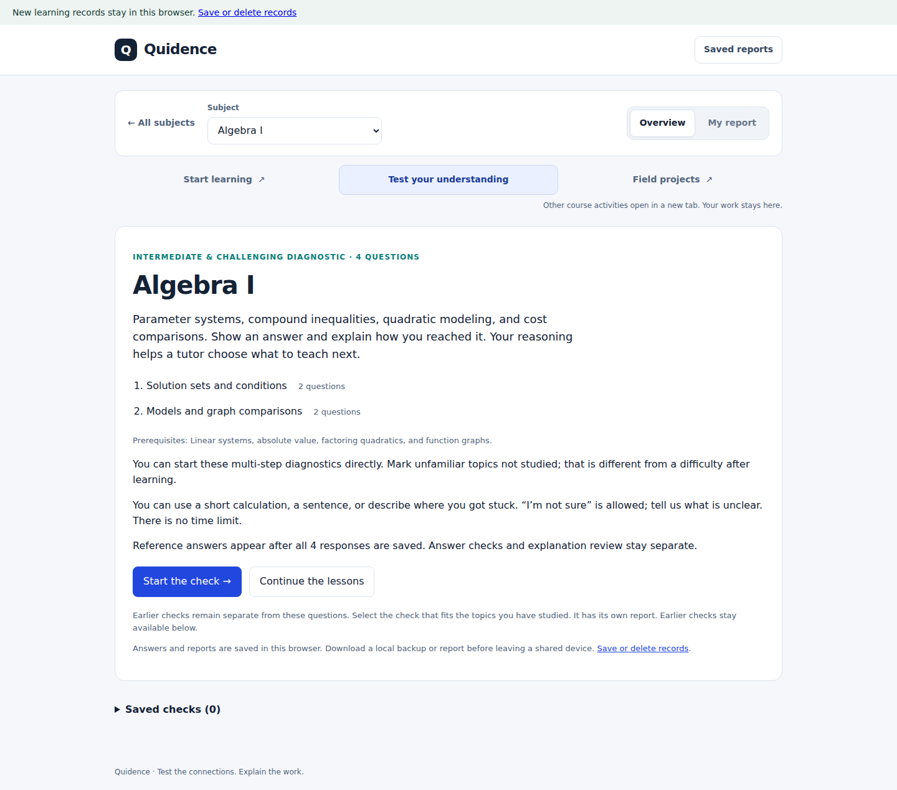
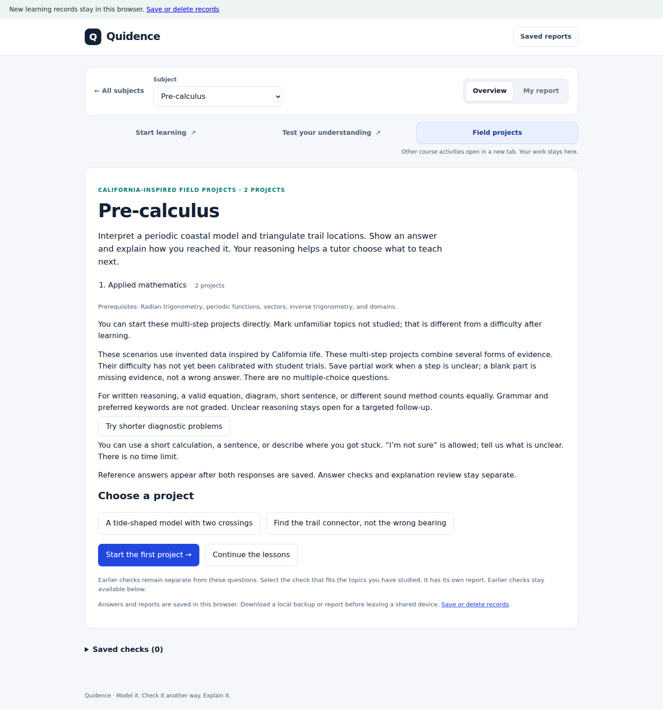

# 專題與檢查入口：資源版本和瀏覽器迴歸

日期：2026-10-08。使用者回饋所有 Explore two field projects 仍顯示舊介面，Test your understanding 版面異常；兩張上傳截圖均已讀取，使用者截圖不提交儲存庫。

## 問題與改動

檢查頁截圖含新版頁頭，卻沒有對應頁頭樣式，仍顯示舊 Start here 導航；專題頁顯示舊黑色頁頭。在真實瀏覽器中完整載入當前 main，分層導航和居中版面正常。這說明截圖中的頁面沒有完整使用同一版本的程式；僅憑截圖無法區分瀏覽器快取與本機目錄中部分檔案未更新。

- 基礎檢查、診斷和專題頁的所有本機 CSS/JS 引用帶實際內容指紋。資源變化會生成新 URL，避免新版 HTML 繼續讀取舊共用樣式或腳本。
- 首頁及課程頁的活動入口也帶頁面內容版本，避免已有快取的舊專題 HTML 阻止新資源載入。活動導航和專題正文裡的短診斷連結同步帶版本。
- 頁面生成器自動更新活動入口；`npm run version:activities` 可重新生成全部版本，`npm test` 檢查提交中的版本是否與實際內容一致。
- 頁頭統一盒模型，品牌入口至少 44px 高；專題介紹不再誤稱為 diagnostics。
- 增加 Playwright 開發依賴和獨立 Chromium 迴歸腳本，接入 GitHub Actions。日常啟動仍無需安裝第三方執行依賴。

只更新介面、URL 與開發檢查；題庫、評分、儲存鍵、原始作答和歷史定義沒有改動。URL 的版本參數不改變瀏覽器儲存來源。

## 驗證

- 完整 `npm test`：211 項通過，0 項失敗。
- 真實 Chrome Headless Shell 149.0.7827.55 / Playwright 1.62.1：十科的兩個入口，在 1440、768、375、320px 共 80 組頁面版面檢查通過。頁頭與正文居中對齊，控制項在螢幕內，無頁面橫向溢出，導航觸控目標至少 44px。
- 桌面和手機共 40 組實際作答草稿流程通過：填寫分數和解釋，切學科並返回，重新整理，開啟另一活動的新標籤頁並返回。原草稿保持可繼續，未完成時報告不可用。
- 快取迴歸在隔離瀏覽器裡先快取模擬舊文件、CSS 和腳本，再切換到當前程式；確認舊資源仍在 HTTP 快取後，從首頁及專題正文進入活動，正確載入新導航和樣式。測試沒有關閉瀏覽器快取。
- 頁面錯誤和失敗請求均為 0。靜態發布清單及連結檢查通過，共 128 個資源，內部文件、測試和截圖不進入公開包；`git diff --check` 通過。

本輪不代表 Safari、Firefox、macOS/iPad、觸控作圖或 PDF 列印已經驗收；這些仍按當前狀態表繼續核對。

## 實際網頁截圖

檢查頁，Algebra I，1440px：

專題頁，Pre-calculus，1440px：

375px 截圖：[檢查頁](review/activity-layout/diagnostic-375.png)、[專題頁](review/activity-layout/projects-375.png)。均為隔離測試瀏覽器的空白介紹頁，不含學生記錄。

## 本機更新

停止原伺服器，完整更新原程式目錄，再執行 `npm start`，用原瀏覽器和原地址從首頁進入活動。若仍顯示舊文件，可強制重新整理（macOS：Cmd+Shift+R；Windows：Ctrl+Shift+R）；無需刪除網站資料。頁面版本不能替代更新磁碟上的完整程式檔案。

本輪作為追加修復提交審核，尚未合併或發布至 www.quidence.com。PR #17 的原導航改動已合併；它的審核文件保留當時未進行真實瀏覽器驗證的範圍。
